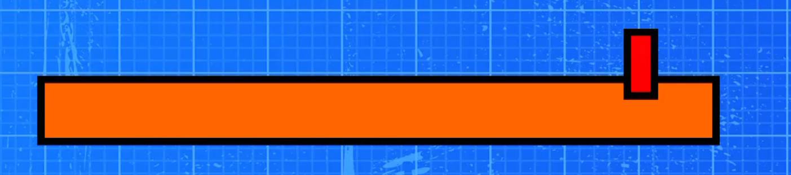
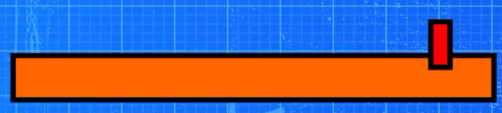
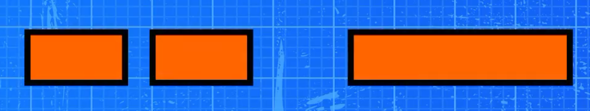
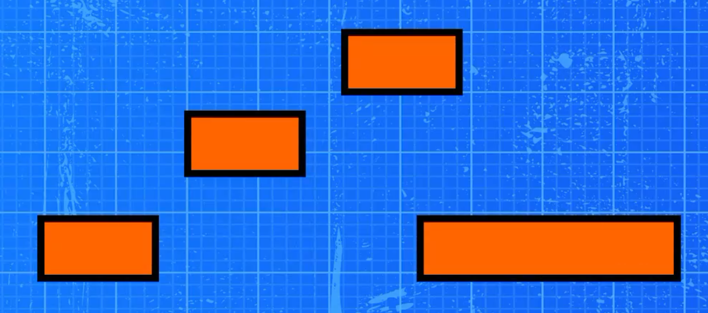
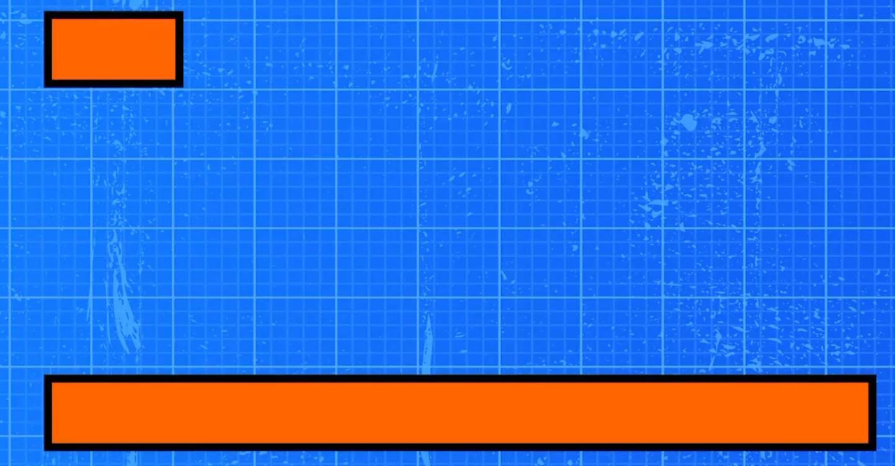

第一个任务是开始搭建。我们刚拿到一张任务单。设计基础的横版平台跳跃玩法。如果你以前从没做过游戏设计，这听起来可能很简单，就像横版游戏嘛，不就是移动和跳跃。但移动是玩家最先接触到的东西。所以如果移动手感哪怕有一点点不对劲整个游戏都会让人觉得不对劲。好消息是，我们只要五步就能设计出扎实的横版平台跳跃玩法。不用写代码，也不用折腾引擎参数。不，相信我，感觉好得很。只要明确目标、规则和公式就行。就是那种你能交给工程师然后真能做出我们想要效果的游戏规格。就这么办。

# 设定比例（基准），编写移动契约

第一步，确定音乐的音阶然后写出乐章的契约。在选数字之前，我们需要一种通用的语言。

## 什么是“尺度（比例）”

音阶就是指，在你游戏里，一个单位代表什么。 对于平台游戏最简单的设计单位就是图块。 就算你的引擎用的是米或单位你还是可以用图块来设计。所以，在本期视频里，我们就用图块来说明。一个简单的基准是 你的角色大概占两个图块高。平台和空隙，也都用图块来衡量。你一看关卡，就能立刻明白各种距离。

## 移动规则

现在我们来做一件我在制作时总会做的事。也就是“移动规则”。一份移动性能合同，本质上是一种承诺而不是一种感觉，是可衡量的承诺。它回答了这样一个问题对于一个基础平台游戏，移动性能到底该做到什么程度？我们设定了五个目标。

### 最高奔跑速度

目标一：最高奔跑速度，也就是Vmax。这是角色在平地上的最高水平速度。有个对新手很友好的方法来确定这个数值。别一开始就定一个数字。先从一个句子开始。比如，我希望玩家能在大约 1.5 秒内走过 10 个格子。这就是一个明确的设计目标。这意味着最大速度 V-Max 大概是每秒 6 到 7 个格子。你不需要做到完美。你需要一个可以测试的目标。

### 达到最高奔跑速度所需的时间

目标二：达到 Vmax 所需的时间，TXL。这决定了角色加速到全速的快慢。这就是响应速度。这是干脆利落，还是拖沓笨重。典型的感受范围。干脆利落 0.12 到 0.25 秒。 平衡 0.25 到 0.40.重型 0.40 到 0.60.要选一个有现代感的平台基础游戏咱们就设 TXL 等于 0.25 秒。

### 停止时间

目标三， 停止时间，T- 停止。松开输入后，角色停下来的速度就是这么快。这是滑动偏滑还是偏紧的对比。说实话，这也是导致移动手感差的最主要原因之一。通常范围是偏紧的 0.08 到 0.18 秒。正常是 0.18 到 030.偏滑是 0.30 到 0.60。我们选 t-top 等于 0.18 秒。

### 跳跃高度

目标四。跳跃高度 H。跳跃高度不等于跳跃力度。它只表示一次满跳能跳多高。新手基准值 H 等于三格。这样既能保证平台跳跃的趣味性，又不会感觉太飘。

### 达到顶点时间

目标五，达到顶点时间。T up。顶点指的是跳跃的最高点。达到顶点时间，就是到达那个最高点所需的时间。这一点很重要，因为两次跳跃可能高度相同但给人的感觉却截然不同。高度相同，但达到顶点的时间更短就会感觉 干脆利落、响应迅速。高度相同，但上升速度变慢，就会显得又飘又慢。一个合适的基准值设为0.35秒。

这就是第一步。如果你是新手，光是这一步就已经是真正的游戏设计了，因为你不再靠猜了。你是在朝着可衡量的结果进行设计。现在，我们要把这些目标转化成移动规则。

# 地面移动规则

第二步，地面移动规则。加速、减速、转向。现在我们设计地面上会发生什么。我们用大白话来定义两个词。

## 加速

加速就是你获得速度的快慢。如果角色启动时感觉很慢，那就是加速太低了。如果角色能瞬间达到最高速，那就是加速很高。

## 减速

减速度，就是你失去速度的快慢程度。如果松手后角色还在滑行，说明减速度太低了。如果角色瞬间停下，说明减速度很高。

这里有个设计技巧。这些数值我们不是靠猜的。而是根据设计规格推导出来的。地面加速度。一个简单的关系式是：加速度约等于最大速度vmax除以T，加速度常数。所以如果你的Vmax大概是6.7，而T加速度是0.25，那加速度大概就是6.7除以0.25。差不多是26.8 格/秒²。你不用非得喜欢这个单位。你只需要明白它为什么存在。地面减速，也是同样的道理。减速约等于最大速度除以停止时间6.7 / 0.18大概是37.2。选这个数是为了让你在大约0.18秒内停下来。新手们通常又会低估这一点有多重要。一款平台跳跃游戏，如果跳跃手感不错但刹车却很拖沓，整体体验照样会很差。

## 转向

这是大多数人会忽略的部分。转向就是你正向右跑，突然按下左键。如果转向时用的加速度和起步时一样角色就很容易出现漂移。而玩家会把这种漂移理解为操作不听使唤。所以，我们加了一条设计规则。转弯时的力度通常应该比普通加速更强。我们用乘数来实现这一点。转弯乘数。典型范围是 1.7 到 1.8。我们选 1.5 作为一个不错的基准值。也就是说，反向时，加速度会变成 1.5 倍强。就是这样。一条清晰的规则。影响巨大。

## 地面测试

简单的车道。先别在真实关卡里测试。你会把自己绕晕的。画一条带距离标记的平直赛道。然后测试三样东西。从静止状态开始测试。保持向右。它能在0.25秒左右达到最高速吗？25秒？停止测试。全速前进，然后松开输入。它会停在0附近吗？18秒，还是会继续滑行？转向测试。向右跑，然后猛地向左。感觉是干脆利落的转向，还是在漂移？如果在漂移，就把转向倍率稍微调高一点。如果感觉太灵敏，就稍微调低一点。好了，地面移动搞定。现在我们来设计跳跃。

# 跳跃弧线

第三步，跳跃弧线。设计时要考虑高度和时机，而不是凭感觉。大多数新手都是这么做的。他们会不断调整重力和跳跃，直到感觉差不多行为止。但在制作里，这很危险因为“差不多行”可能会变成三天都在调整。所以，我们用的是“移动契约”法。我们已经选好了跳跃高度和到达最高点的时间。这样我们就能算出跳跃参数了。我们再定义两个简单的概念。游戏设计中的重力。游戏重力不等于现实中的物理重力。它只是为了游戏性而设定的向下拉力数值。跳跃速度。也就是起跳瞬间的初始向上速度。好，下面是我们用的公式。如果想让跳跃达到高度 h并用 t up 秒到达顶点，那么重力大小g= 2 h / t up 的平方。初始跳跃速度 V jump等于 2 H 除以 T up。现在，我们的基准是 H 等于三格T up 等于 0.35 秒，你就会得到 重力约为 49，跳跃速度约为 17。1。重点来了。 这并非随机设定。这是设计好的。这个跳跃会特意设定好目标高度和时机。

## 如何在不破坏整体效果的情况下改变跳跃手感

如果跳跃感觉太飘，但高度没问题，就别动高度。修改到达最高点的时间。如果想让跳跃更有力度，就把 t 调低，比如 0.30，然后重新计算。 如果想让跳跃更飘就把 t 调高，比如 0.40，然后重新计算。 这是控制跳跃特性的最干净方式。再加一条规则。终端速度。最大下落速度。下落时，速度往往会一直增加。如果让它一直加速，从高处落下就会变得无法控制。所以，我们设定了一个最大下落速度。可以叫它最大坠落速度，或者终端速度。新手的基础值大概是每秒 18到 28 个图块，具体要看比例。就先定 22 吧。这样长距离坠落时，感觉才稳定又可控。好，跳跃弧线搞定了。

# 空中控制

第四步，空中控制。 修正与锁定。空中控制，其实就是我起跳之后能有多大程度的转向。如果控制得太强，感觉就像在飞。太弱的话，又觉得不公平。所以，我们用三个参数来定义空中控制。空中最高速度通常和地面速度的基准值差不多。空中最高速度等于0.9比1。Vmax的0. 咱们简单点。最大空速等于1。0 Vmax。空中加速通常比地面慢，所以起跳后还得继续。基础空速等于0.5到0.地面的8，地面XL大概是26。8，所以基础空速可能在17左右，咱们就设空速等于0吧。地面是65 ，所以大概是17。4，空气减速或阻力。这个值决定了松开输入后，你在空中停止加速的速度。如果没定义这个值，就算地面手感很稳空中也可能感觉很滑。一个简单的空气减速基准值，大概在空气加速值附近，或者稍低一点。可以先从 空气减速等于15这样的值开始。

## 空气测试

超级实用。在你的测试房间里，搭建一个几乎够不着的平台。然后这样做。朝它跳过去，试着在空中调整。如果感觉力不从心，就稍微多呼出一点气。如果你能立刻反向，还能完美落地，就减少呼气。你的目标就是这个。你可以纠正失误，但无法撤销已经做出的决定。好了，现在我们最终确定交付成果。

# 测试室

第五步，测试室。如果你是新手，这里有个关键思路。你不用在真实玩法里去平衡移动。首先， 你要建一个移动实验室也就是一个小小的测试室。测试室需要什么？五个区域。速度通道，带标记的平坦地面。

在这里，你要验证最大速度和加速时机。停止 车道。

还是同一条车道，但你要练习在标记点停下。在这里你能感受到路面是滑还是稳。设置间隙。

一个需要短距离跳跃的小间隙。一个需要全力 冲刺再加跳跃的中距离间隙。楼梯。

三到六个平台，每个都比前一个高一个方块。这考验的是重复性和节奏感。很高的坠落点。

这考验的是下落时的终端速度和空中控制。现在你可以清晰地进行调整了。紧凑的包。那些让操作显得专业的小规则。这些不会改变核心的五个步骤。它们能让游戏在好的层面上感觉像是在读懂玩家的心思。

## 郊狼时间

一个极短的缓冲窗口，让你离开平台后还能马上起跳毕竟人做不到帧级操作。典型的 0.08 到 0.15 秒。从 0 开始0.102。

## 跳跃缓冲

如果落地前稍微按一下跳跃游戏就会记录下来，落地时自动跳起来。这样就解决了“我按了跳跃”的抱怨。典型的 0.08 到 0.15。从 0 开始0.103。

## 跳跃高度可变

轻点和长按的区别。如果玩家在上升时提前松开跳跃键就会抵消向上的速度。这样就能实现小跳和全力起跳。这就是技巧的体现。可以设置一个参数，比如跳跃削减倍率0.4到0.7。从0开始0.554.

## 下落速度加快

如果下落比上升更快，很多平台游戏的体验都会更好。这能减少漂浮感，提升操控性。下落倍率设为 1.3 到 2.2。先从 1 开始0.7。

这就是完整的方案。目标、规则、公式、测试、交付规格，再加上让整体感觉更紧凑的打磨。