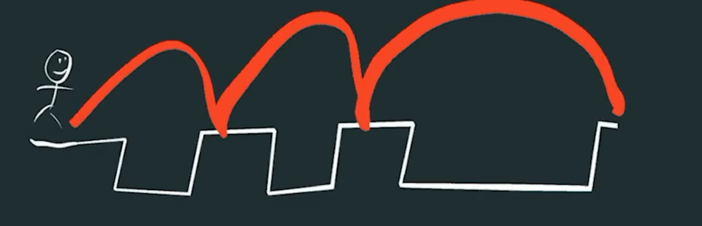
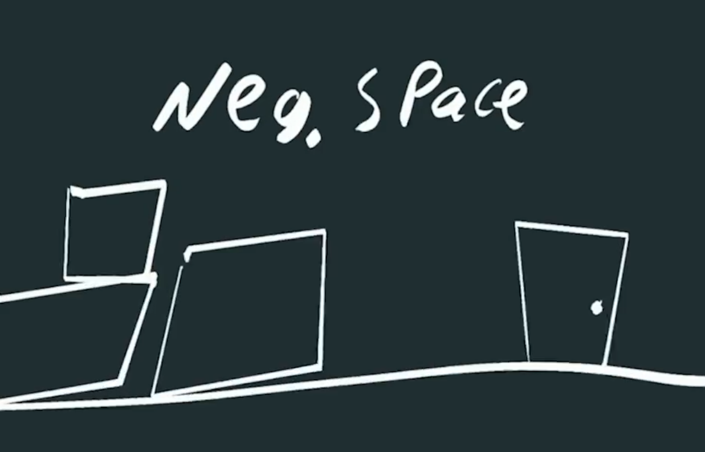
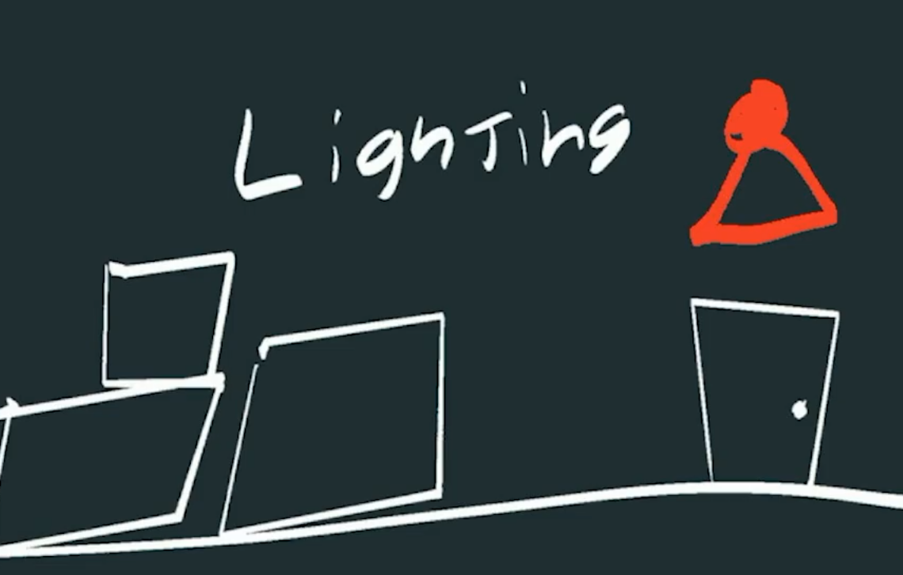
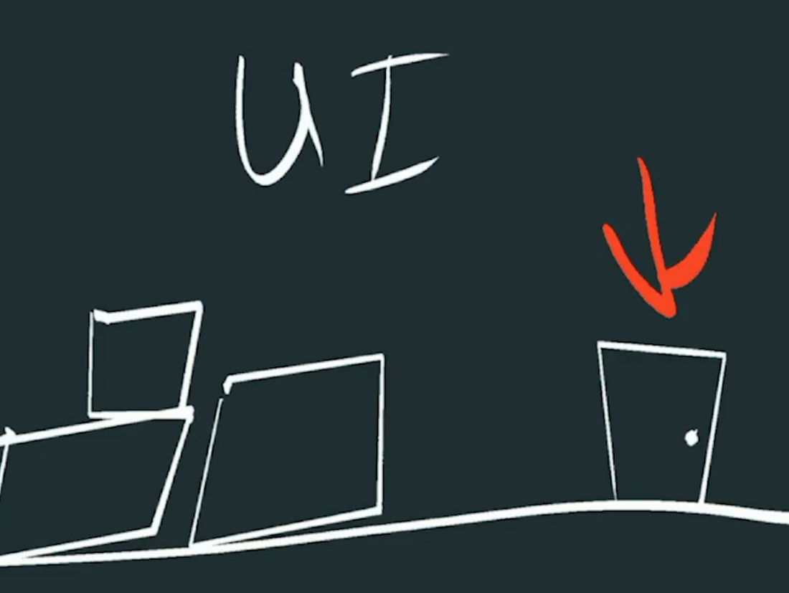
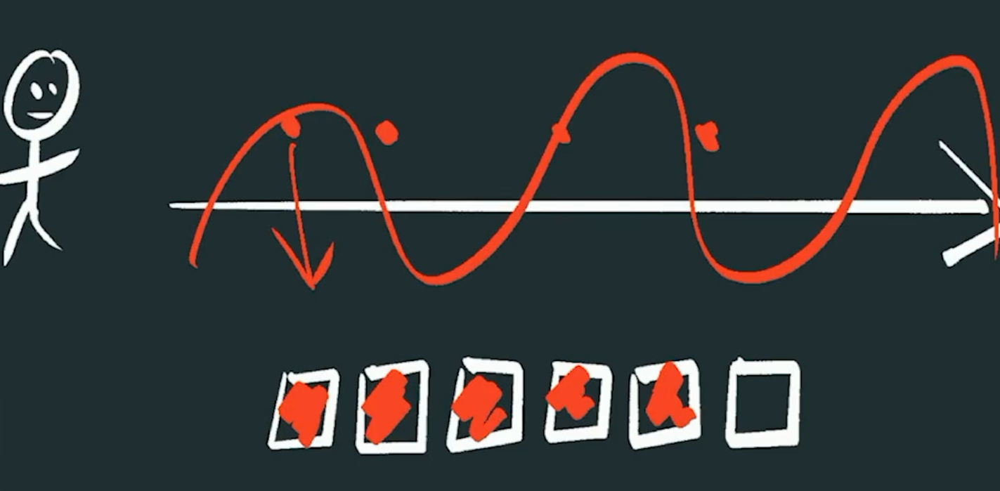
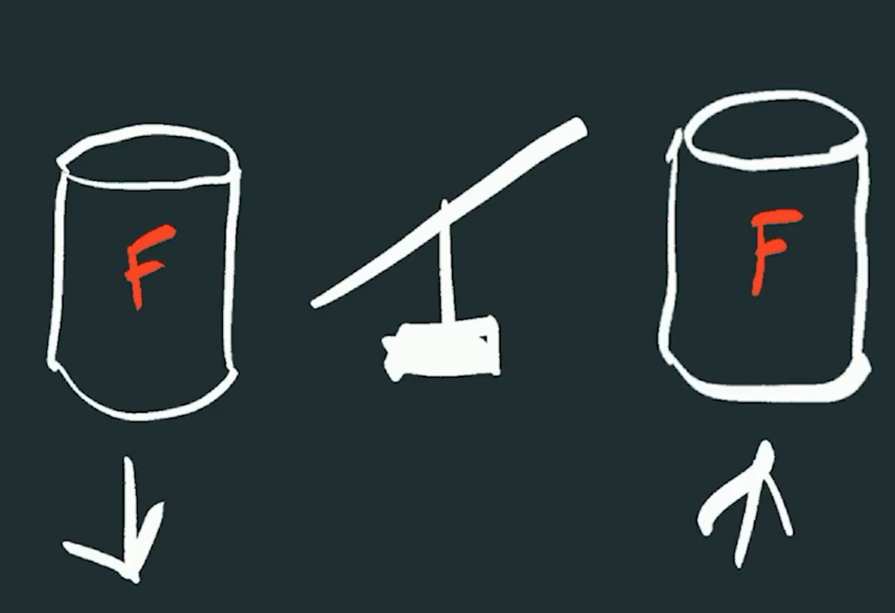
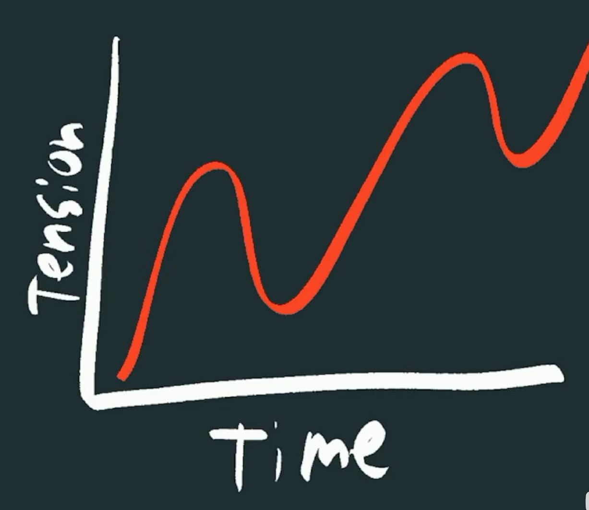

# 可供性，Affordance

可供性是一种设计元素，表明产品应该如何使用

例如看到铲子就能猜到挖

看到斧子就能想到切

如果一个什么都不是的东西会让玩家花费额外的精力去理解。

并不是所有东西都必须是可供性，但是可以通过使用玩家熟悉的事物，可以减轻很多认知负担。

某个东西像按钮所以玩家会按下他。

所以生存类游戏可以做得非常复杂，因为它们利用了可供性并有效利用了它。

如果你有东西与众不同，就需要花大量的精力教玩家这是什么以及需要学习什么。

# 认知负荷，Cognitive Load

认知负荷是玩家需要同时思考的事情的数量。

如果游戏内容丰富，复杂度高，那么玩家的认知负荷可能会更高。

假设如果每局游戏的认知负荷预算是10，没有教程或引导让玩家感到困惑和无法真正明白，那可能是7，加上可供性不明确的话是+1，假设无法认识敌人行为模式+2。那么玩家可能会选择离开。

你想尝试做的事之一是降低认知负荷，这并不总是意味着降低复杂性，是指教程和介绍更慢、更有趣、更有条理，以便向玩家展示它们。

然后还需要了解玩家一次需要记住多少东西。例如棋盘游戏和棋子技能。

所以要注意你一次性增加了多少认知负荷，玩家需要同时记住多少信息

# 框架塑造，Framing

框架效应是指如何呈现一个选择比选择本身更重要。

框架效应是指事物的措辞或呈现方式实际上会影响人们的选择，像这样简单的操作就能对玩家的决定产生很大的影响。

例如平静的音乐和激昂的音乐对角色的表现。

例如画和画框。

对你的游戏来说，画框和画本身一样重要

# 组块化，Chunking

分块是指将大量信息拆分成更小、更易于处理的信息块。

例如一大段长文字拆分为三部分。可以把这种方法用在教程、剧情、背景设定、任务、UI和操作机制上。

例如玩家必须学习操作机制如 蔚蓝 ，不用一次雪绘所有关于跳跃的复杂操作，有一个教学关专门教如何跳跃完成特定动作，然后进入下一个教学关学习，这样就把信息拆分为一个个好掌握的块。要怎么把你要传达给玩家的信息拆分为更小的部分。

# 能动性，Agency

能动性是指玩家能在游戏里做出有意义选择的能力。

一个选项无论怎么选最后都是一个结果，玩家不喜欢无关痛痒的决定。

如果有多个结果，那么错失恐惧是真实存在的，它也是玩家拥有自主权的重要一部分，他们需要感受到那种错失感，才能做出有意义的选择。

在开放世界游戏里经常看到高度自主性，你的决定至关重要，你拥有高度的自主权。这种游戏设计能让你创造出充满自主性的世界。但这并不意味着你的选择必须真的产生影响，它指的是玩家要觉得自己的选择很重要。

例如传说之下，能自主选择当好人还是坏人。

通常来说，玩家感觉越能掌控全局，体验就越好。

# 颠覆预期，Subversion

颠覆就是打破玩家的预期，给他们一个惊喜。例如两次普通跳跃后接着一个大跳。

所以基本上你会在游戏设计里植入这种模式，不管是机制、剧情还是其它方面。

反套路设计，玩家会很喜欢。

传说之下就是颠覆了玩家的预期

# 路标引导，Signposting

所谓路标引导，就是通过视觉线索来引导玩家，而且玩家通常不会太注意到。

最直接、最基础的做法就是真的设置一些路牌。

其实还有很多不那么明显的方法可以做到这一点。

## 1 纯粹的留白

留白就是什么都没有的空间，那个空间是空的，这样一来焦点自然就落在了门上。

留白是很好的指引方式

## 2 灯光

灯光是指引方向的好方法

显示红绿灯表现门是否上锁也是指引的一部分

## 3 UI

可以先留出留白，如果玩家过几分钟还没有明白，就可以让那个箭头出现。

例如解密游戏中有一个颜色与其他不同，玩家就不需要考虑其他几个了，就是能互动的。

## 4 易读性，Legibility

易读性就是能不能一眼看出那是什么东西。

惯性思维。

让玩家能看懂那东西是什么。

清晰易懂，但同时打造更休闲、更轻松的体验，这并不意味着你要把一切都交代清楚，也不意味着需要巨大的UI来指路，更不意味着把游戏做得对玩家来说易如反掌。

这仅仅意味着，如果玩家在看一个物体，要确保他们能明白它大概是什么。

你也可以反其道而行，利用这种反转。

保持东西清晰易懂。

## 5 阻力，Friction

阻力就是那些让玩家慢下来的小麻烦

随时间的推移让你慢下来

事件会随着时间的推移变得令人沮丧，阻力会减缓你的进度。

现在，不是所有的阻力都是坏事，

游戏不是一直快速也不是全是缓慢的

阻力和乐趣。

不是所有的阻力都是不好的。

但是如果你的菜单或UI界面又笨重又难看，那么就别那么搞。那是不必要的阻力，绝对要从游戏里删掉。

不想把预算浪费在那些本可避免的破事上。

要专注于好的UI设计。

别故意整出走路超慢的动画之类的东西。

试着用阻力来尊重玩家的时间。

但你也可以用不同方式来减慢剧情节奏，或减缓某些进度。

例如准备boss战但是玩家没有准备好，可以加点阻力为这场boss战制造期待感之类的。

也可以用有趣的方式运用他。例如让玩家学习一套新的操作方式作为阻力。增加沉浸感，让玩家感觉融入了这个世界。

## 6 节奏，Pacing

节奏是紧张感和动作的韵律

紧张感和时间应该是波动上升的。

如果一直都是紧张感玩家就不那么喜欢了，释放紧张感很有帮助。

你要做的就是先营造紧张感，然后释放他，再营造紧张感，再释放他。

节奏感就是掌握这个过程的韵律。

也是一种叙事方式，可以把它想象成玩家正在乘坐的过山车。

这能打破单调，让体验更令人难忘，因为他能让你的大脑更好地记录这些记忆。

## 7 玩家幻想，Player Fantasy

这部分的设计思路就是围绕玩家梦想成为的样子展开。

仔细想想，你到底想让玩家有什么样的感觉？你到底在呈现一种什么样的幻想？

从类似这样的想法出发，其实就能决定游戏的机制，决定原型的设计，决定你最终要制作和建造什么。

因为如果你希望玩家产生某种特定的感觉，从一种幻想开始绝对是好主意。

一旦你确定了自己想成为、操控或建造什么，也就是确定了你的幻想，接下来就是挑战了。

先有幻想这种方法的妙处在于你大概就能想清楚挑战是什么。

是什么，目标是什么，做什么。

这对玩家的代入感和整个游戏的连贯性来说真的非常重要。